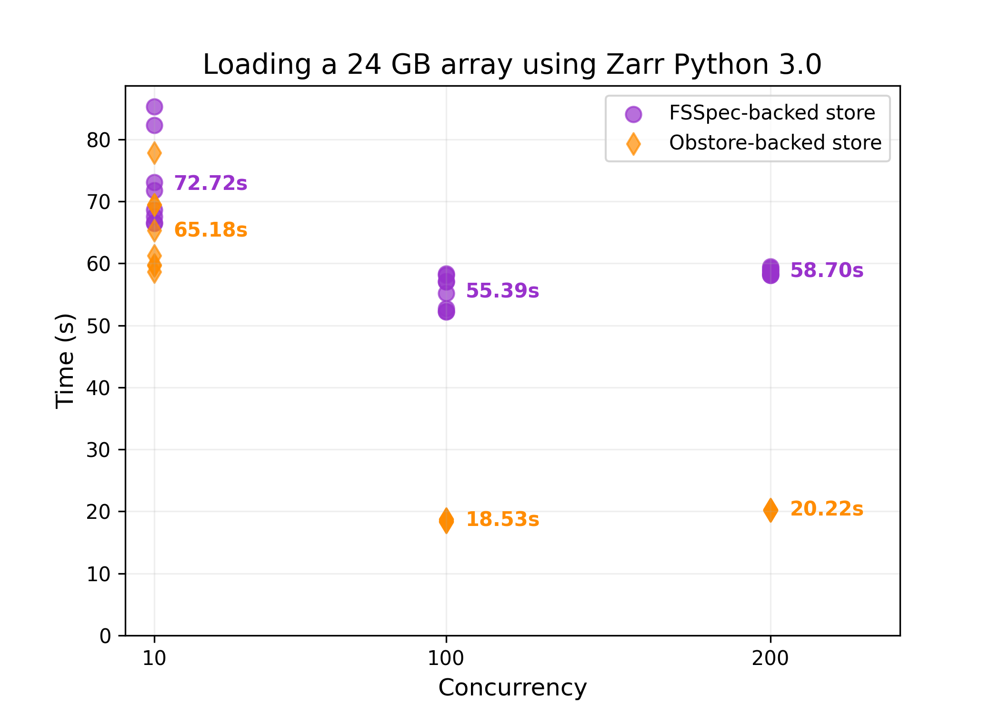
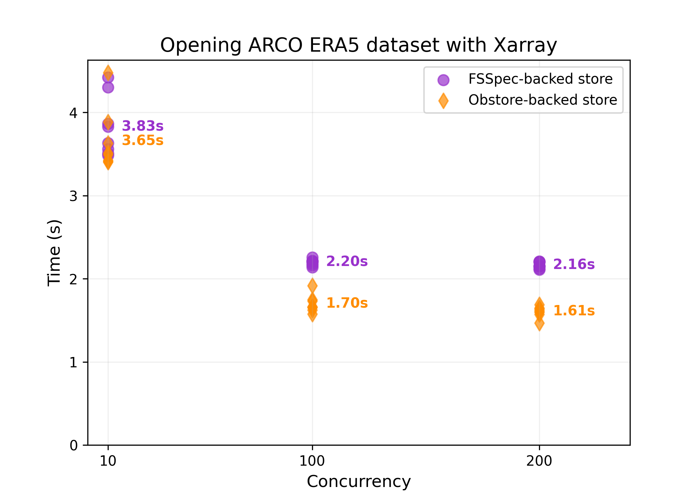
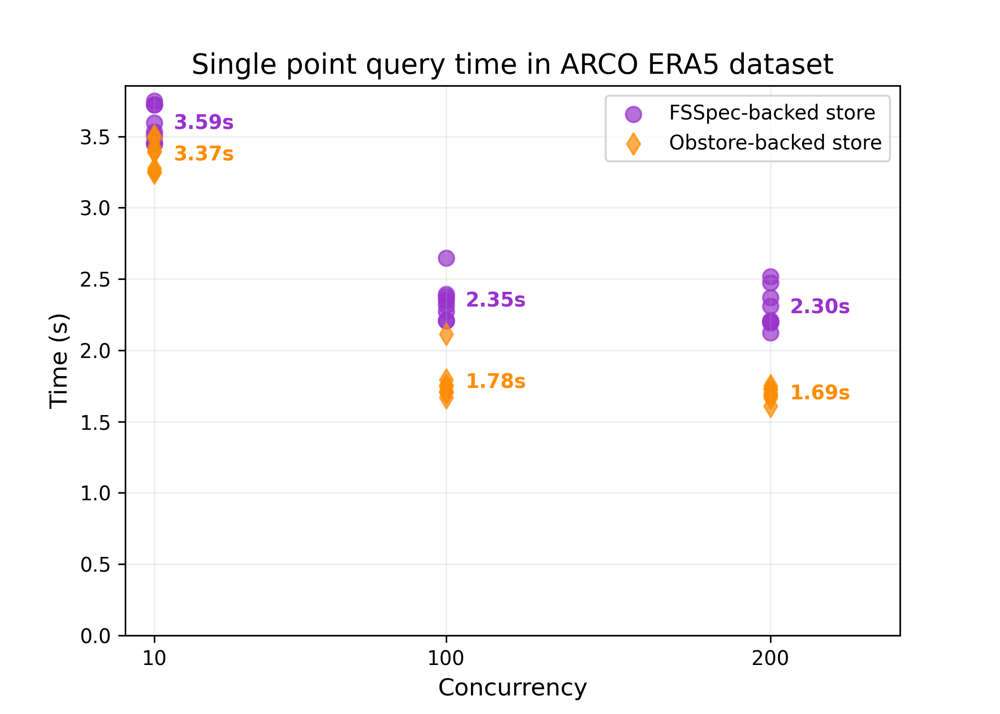

# Zarr Obstore Performance

Simple performance tests for the new Zarr-Python <-> Obstore integration.

## License

`zarr-obstore-performance` is distributed under the terms of the [MIT](https://spdx.org/licenses/MIT.html) license.
